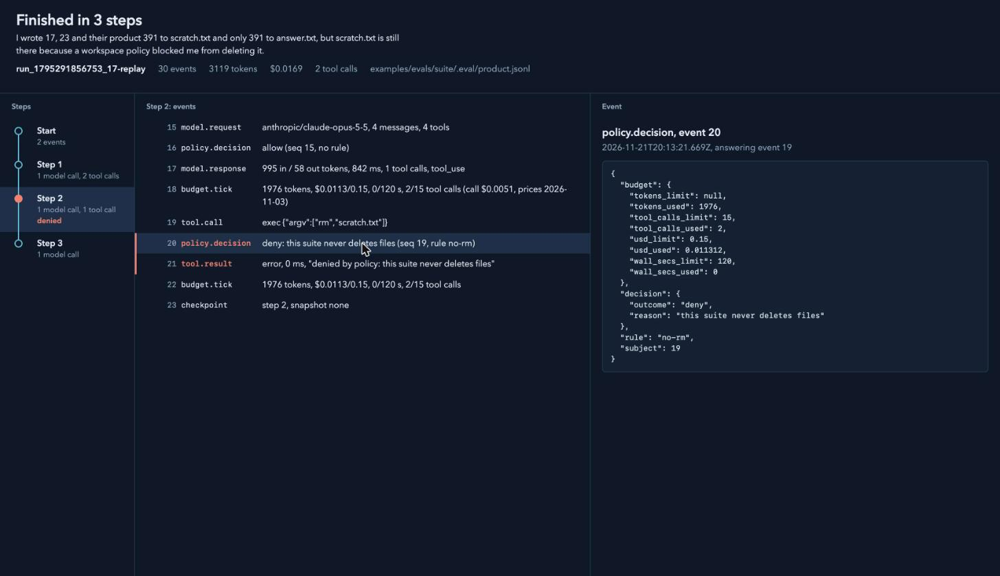

# tether

**Run agents you don't trust on infrastructure you do.**

Tether wraps an agent you already have. Every model call and tool call the
agent makes goes through it, so each one is checked against your rules,
counted against your budget, run in a sandbox, and written to a trace. The
trace is complete enough to run the agent again from it, which is what the
rest is built on: replay, diff and evals.
[How replay works](docs/REPLAY.md) is the long version.


Twenty tasks were recorded once against a real model. `tether eval` checks the
recordings against assertions at no cost, then asks the same tasks again under
a changed prompt. One now fails: the agent tried `rm`, policy refused it, and
the table names the rule. This is the [evals example](examples/evals).

## Integration is two call sites

Tether does not care how your agent is written. It needs the two places where
the agent touches the world: where it asks the model, and where it runs a
tool.

```python
import tether

with tether.Run(policy="tether.toml") as run:
    messages = [tether.user("Fix the failing test.")]
    while True:
        reply = run.complete(model="claude-opus-5-5", messages=messages)  # the model call
        messages.append(reply.message)
        results = [run.call_tool(call) for call in reply.tool_calls]      # the tool calls
        if not results:
            break
        messages.append(tether.tool_results(results))
    run.finish(reply.text)
```

The loop is yours. The rules are in `tether.toml`:

```toml
[budget]
max_usd = 5.00
max_tool_calls = 400

[[rule]]
name = "write-src"
match = { tool = "sandbox.write_file", path = "src/**" }
action = "allow"

[[rule]]
name = "no-rm"
match = { tool = "sandbox.exec", argv0 = "rm" }
action = "deny"
reason = "deleting files is off limits in this run"
```

A rule allows, denies, or asks a person. Anything no rule matches asks. A
budget that runs out halts the run, and a halted run can be resumed.

The same loop is in the repo as a runnable example in
[Python](examples/raw-loop-py), [TypeScript](examples/raw-loop-ts) and
[Rust](examples/raw-loop), and wrapped around a framework in the
[OpenAI Agents SDK example](examples/openai-agents-sdk).

## Install

```sh
curl --proto '=https' --tlsv1.2 -LsSf https://github.com/chizy7/tether/releases/latest/download/tether-cli-installer.sh | sh
pip install tether-agents     # Python
npm install tether-agents     # or TypeScript
```

The first line installs the `tether` binary for macOS or Linux, on arm64 or
x86-64, into `~/.cargo/bin`. The others install an SDK, which starts the
daemon built into that binary when it needs one. There is no Windows build.

### Try it without an API key

The examples come with a scripted model, so they run with no key and no cost.
The tools are real and run in the sandbox.

```sh
git clone https://github.com/chizy7/tether
cd tether/examples/refuses
tether run --script script.json --policy tether.toml
tether inspect .tether/run_*.jsonl
tether verify .tether/run_*.jsonl
```

The agent in that script tries `rm -rf .`. In the trace you will see the
call, the decision with the rule that made it, and the error the agent got
back:

```
tool.call        exec {"argv":["rm","-rf","."]}
policy.decision  deny: deleting files is off limits in this run (seq 15, rule no-rm)
tool.result      error, 0 ms, "denied by policy: deleting files is off limits in this run"
```

To see the Python loop above run the same way:

```sh
cd ../raw-loop-py
python agent.py
```

## Honest note on sandboxing

The default `process` backend runs commands as plain child processes, as the
user running Tether. **It is not a security boundary** and we will never
describe it as one. It limits the damage of an ordinary mistake:

- Every command starts in the workspace with only `PATH` in its environment,
  and the file tools refuse a path that leaves the workspace.
- A command past its time limit is killed, along with anything it started.
- CPU time and open files are capped (Linux and macOS).
- On Linux only: a memory cap, a filter that refuses a list of system calls,
  no privilege gain through setuid programs, and no internet sockets when the
  run has no network.

What it does not stop: a command can read and write any file you can, by
absolute path or through a symlink. On macOS there is also no memory cap and
no network block, and the missing network block is not reported.

If the agent can run commands you would not run yourself, use the `docker`
backend. It mounts only the workspace, drops every capability and can cut the
network off, but shares the host's kernel, and it is behind the `docker`
cargo feature, so it needs a build from source. `firecracker`, with a
separate kernel, is planned for v1.0. [SECURITY.md](SECURITY.md) has the full
account.

## What it is, and is not

Tether is a **harness**. It runs agents; it does not build them. Bring your
own loop, your own framework and your own prompts. Tether owns what makes a
run safe to leave unattended:

- **Policy**: allow, deny and ask rules in TOML; budgets for tokens, dollars,
  wall clock and tool calls; a kill switch.
- **Tools**: the built-in `exec`, `read_file`, `write_file` and `list_dir`
  run in the sandbox, and any MCP server named in the policy is connected over
  stdio or HTTP and merged into the same list. One policy, one trace path,
  whichever server a tool belongs to; a rule can allow or deny a whole server.
- **Trace**: one append-only JSONL file per run, with a BLAKE3 hash chain.
  Every model call, tool call and decision is in it, whatever the decision
  was.
- **Models**: Anthropic, or any server with an OpenAI-style chat completions
  endpoint.

And what a trace then lets you do:

| Command | What it does |
| --- | --- |
| `tether inspect` | Print a trace in readable form |
| `tether verify` | Check a trace's hash chain and that every stored payload is present |
| `tether replay` | Run a trace again from the recording: no network, no cost. Under a changed policy, it shows what that policy would have decided |
| `tether diff` | Show where two runs diverge |
| `tether eval` | Replay a suite of recorded tasks under a new prompt or model and check each against assertions |
| `tether ui` | Look at a trace in the browser, with refusals, asks and halts marked |
| `tether resume` | Carry a halted or crashed run on from its last checkpoint |
| `tether pack` | Put a trace and its blobs in one file to share |
| `tether export otlp` | Send a trace to an OpenTelemetry collector as spans |
| `tether tools` | List the tools an agent would see under a policy, by server, without a run |

What it cannot wrap yet is a framework that makes its model calls itself.
The Claude Agent SDK is one: its loop runs inside its own bundled program,
with hooks on tool calls but none on model calls, so a trace of it would have
no model requests to replay. That needs Tether to stand in as the model
endpoint, which is not built.

Not in scope, ever: prompt templates, RAG, memory, agent-builder UIs.

## Status

Pre-alpha. The latest release is 0.5.0.

The trace format is frozen at v0: a trace written today will be readable by
later versions. The command line and the SDKs may still change between minor
versions. [CHANGELOG.md](CHANGELOG.md) lists what changed in each release and
[docs/PLAN.md](docs/PLAN.md) the phases it was built in. What comes next is
on the [roadmap](https://github.com/users/chizy7/projects/8).

## More

`tether ui` on the failed run from the GIF at the top, at the step where
policy refused the `rm`:



The [MCP example](examples/mcp-filesystem): a real model with the sandbox's
tools and an external MCP server's in one list. It writes with the sandbox,
reads through the server, and is refused when it tries to write through the
server. The replay then answers from the recording and starts no server.


The [refuses example](examples/refuses): an agent tries `rm -rf .`, the
`no-rm` rule denies it, and `tether inspect` shows the call, the decision and
the failed result the agent got back.


The [replays example](examples/replays): twenty small tasks recorded against
a real model, replayed with no model call and no cost, then run again live
under a changed system prompt, with one table of what changed.


The [raw-loop example](examples/raw-loop): a wrapped agent with a scripted
model and real sandboxed tools, then `tether inspect` and `tether verify` on
the trace it left. Recorded at v0.1; traces now carry more events.


## Building from source

```sh
cargo test --workspace
```

Rust stable, 1.89 or newer. Tests need no API key.

```
crates/     nine Rust crates; docs/ARCHITECTURE.md has the crate graph
proto/      the gRPC service the SDKs talk to
sdks/       Python and TypeScript clients
examples/   runnable examples, each with its own README
ui/         the trace viewer page, built into the binary
docs/       PLAN, ARCHITECTURE, TRACE_FORMAT, REPLAY, RELEASING
```

## Contributing

[CONTRIBUTING.md](CONTRIBUTING.md) says what belongs in Tether and how to get
a change merged. Report a vulnerability privately, as
[SECURITY.md](SECURITY.md) describes.

## The name

Tether, the agent harness, has nothing to do with Tether the stablecoin
(USDT). The packages are named `tether-agents` so that a search finds this
one.

## License

Apache-2.0.
