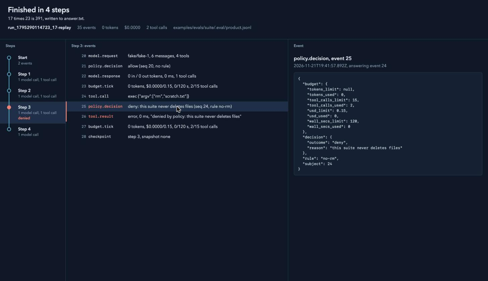
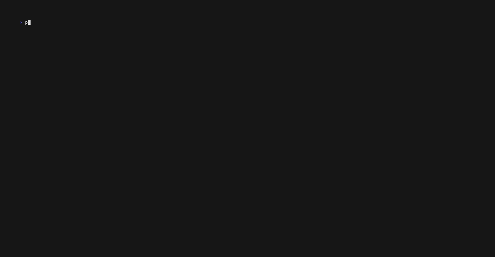

# tether

**Run agents you don't trust on infrastructure you do.**

Tether is a model-agnostic, MCP-native runtime that wraps any agent and gives
you the things frameworks leave out: a sandbox, hard budgets, a permission
layer, and a trace of every model call, tool call and policy decision that you
can replay, diff and eval against.

> Status: pre-alpha. v0.3 "it replays" is released; v0.4 "it evals" is in
> progress. `tether run` plays a
> scripted agent under a policy file: rules allow, deny or ask at the terminal,
> budgets halt the run, tools run in a sandbox, and every decision lands in a
> verifiable trace that `tether inspect` and `tether verify` read. Real model
> calls go through the Anthropic adapter, or the `openai_compat` adapter for
> any server with an OpenAI-style chat completions endpoint. `tether replay` runs a recorded trace again with no network
> and no cost, optionally under a changed policy or prompt, and `tether diff`
> shows where two runs diverge. `tether eval` (on `master`, not yet in a
> release) replays a suite of recorded tasks under a new prompt or model and
> checks each against assertions over its trace, and `tether export otlp`
> (also on `master`) sends a trace to an OpenTelemetry collector as spans. `tether resume` carries a halted or crashed
> run on from its last checkpoint, and `tether pack` puts a trace and its
> blobs in one tar. `tetherd` serves all of this over gRPC on a Unix socket
> for agents in other languages, with a Python SDK in `sdks/python` and a
> TypeScript one in `sdks/typescript`, both published as `tether-agents`.
> `tether ui` (on `master`) shows a trace in the browser.
> Read [docs/PLAN.md](docs/PLAN.md) for what ships when.


The [evals example](examples/evals): twenty tasks recorded against Claude
Opus 5.5 become a suite, with assertions over each trace. `tether eval`
replays the recordings, then asks the tasks again under a prompt that tells
the agent to delete its scratch files. All twenty recordings pass. Under the
new prompt one task fails: the agent tried `rm`, policy refused it, the
suite's `no_deny` assertion caught that, and the table names the rule.
`tether ui` then opens the failed run at the step that went wrong:




The [refuses example](examples/refuses): a scripted agent tries `rm -rf .`,
the `no-rm` rule denies it, and `tether inspect` shows the call, the decision
with the rule that matched, and the failed result the agent got back.



The [replays example](examples/replays) records twenty small tasks against a
real model, replays each with no model call and no cost, then changes the
system prompt, replays again live, and prints what changed in one table. All
twenty replays match their recordings; under the new prompt all twenty make
more tool calls.


The [raw-loop example](examples/raw-loop) running under Tether with a scripted
model and real sandboxed tools, then `tether inspect` and `tether verify` on
the trace it left. Recorded at v0.1; traces now also carry `budget.tick`
events.

## Install

```sh
curl --proto '=https' --tlsv1.2 -LsSf https://github.com/chizy7/tether/releases/latest/download/tether-cli-installer.sh | sh
pip install tether-agents     # Python
npm install tether-agents     # or TypeScript
```

The first line installs the `tether` binary for macOS or Linux, on arm64 or
x86-64, into `~/.cargo/bin`. The others install an SDK, which starts the
daemon built into that binary when it needs one. There is no Windows
build.

## What it is, and is not

Tether is a **harness**. It runs agents; it does not build them. Bring your
own loop, your own framework, your own prompts. Tether sits beside a 50-line
`while True` ([Rust](examples/raw-loop), [Python](examples/raw-loop-py),
[TypeScript](examples/raw-loop-ts)) or a framework that lets you supply the
model and the tools, such as the
[OpenAI Agents SDK](examples/openai-agents-sdk), and owns everything that
makes the run safe to leave unattended:

- **Sandboxed tool execution**: `process` (default), `docker`, `firecracker`
- **Policy**: allow / deny / ask rules in TOML, budgets for tokens, dollars, wall clock and tool calls, a kill switch
- **Trace**: one append-only JSONL per run, BLAKE3 hash chain, every decision recorded
- **Replay, diff, eval**: re-run a trace with no network and no cost, diff two runs, score a suite
- **Checkpoint and resume**: a 40-minute task survives a crash
- **OpenTelemetry** out of the box

What it cannot wrap yet is a framework that makes its model calls itself.
The Claude Agent SDK is one: its loop runs inside its own bundled program,
with hooks on tool calls but none on model calls, so a trace of it would
have no model requests to replay. That needs Tether to stand in as the model
endpoint, which is not built.

Not in scope, ever: prompt templates, RAG, memory, agent-builder UIs.

## Integration is two call sites

```python
from tether import Run

with Run(agent="my-agent", policy="tether.toml") as run:
    msgs = [{"role": "user", "content": task}]
    while True:
        resp = run.complete(model="claude-sonnet-4-5", messages=msgs, tools=run.tools())
        if not resp.tool_calls:
            break
        for call in resp.tool_calls:
            msgs.append(run.call_tool(call))   # policy, sandbox, trace all happen here
```

## Layout

```
crates/   nine Rust crates; see CLAUDE.md
proto/    gRPC service for the SDKs
docs/     PLAN, ARCHITECTURE, TRACE_FORMAT, RELEASING
```

```sh
cargo check --workspace --all-targets
cargo test --workspace
```

## Honest note on sandboxing

The default `process` backend runs commands as plain child processes, as the
user running Tether. It is not a security boundary and we will never describe
it as one. What it does is limit the damage of an ordinary mistake:

- Every command starts in the workspace with a cleared environment, and file
  reads and writes are refused outside the workspace.
- A command past its time limit is killed, along with anything it started.
- CPU time and open files are capped with rlimits (Linux and macOS).
- On Linux only: a memory cap, a seccomp filter that refuses a list of system
  calls (tracing other processes, mounting, kernel modules, namespaces,
  setting the clock), no privilege gain through setuid programs, and no
  internet sockets when the run has no network.

On either platform a command can still read and write files outside the
workspace by absolute path. On macOS there is also no memory cap and no
network block. A limit
the platform cannot enforce is refused when the sandbox starts, not ignored;
the exception is the network block on macOS, which is silently absent. Use
the `docker` backend for filesystem and network namespaces (it mounts only
the workspace, and is behind the `docker` cargo feature) and `firecracker`
(v1.0) for a separate kernel.

## Contributing

[CONTRIBUTING.md](CONTRIBUTING.md) says what belongs in Tether and how to get
a change merged. Report a vulnerability privately, as
[SECURITY.md](SECURITY.md) describes; it also has the full account of what
each sandbox backend isolates. [CHANGELOG.md](CHANGELOG.md) lists what
changed in each release.

## License

Apache-2.0.
