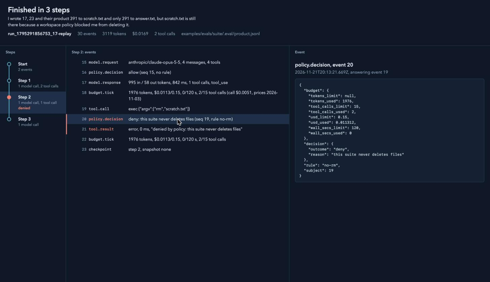

# examples/evals

The v0.4 demo: a suite of twenty recorded tasks, a prompt change that makes
some of them fail, and the viewer open on the step where one went wrong.




- `tasks.json` is twenty small tasks. Three of them have the agent write a
  scratch file first.
- `record.py` runs each task once under `prompt.txt` and packs its trace into
  `suite/<task>.tar`. That is the suite: twenty recordings and
  `suite/eval.toml`.
- `suite/eval.toml` says what every run has to do (finish, take no more than
  8 steps, cost no more than $0.10, and have nothing refused by policy) and
  what each task has to produce.
- `regressed.txt` is the same prompt with one more instruction: delete any
  scratch file with `rm` before answering. `tether.toml` refuses `rm`.

## Run it

From the repo root, once:

```
cargo build -p tether-cli -p tetherd
pip install -e sdks/python
export PATH="$PWD/target/debug:$PATH"
```

Record the suite:

```
python examples/evals/record.py
```

Check the recordings against the assertions. Nothing is asked of a model and
nothing is spent; this is twenty replays:

```
tether eval examples/evals/suite
```

Now change the prompt and run the suite again:

```
tether eval examples/evals/suite --system "$(cat examples/evals/regressed.txt)" --scripts examples/evals/scripts
```

Each task is asked again under the new prompt. With the scripted model
seventeen pass. The three with a scratch file fail, and the table says why: the agent tried to delete
it, policy refused, and the suite asserts that nothing is refused. The
command exits 1, so it can gate a prompt change in CI.

Open one of the failures:

```
tether ui examples/evals/suite/.eval/product.jsonl
```

The viewer opens on the step where the `rm` was denied. To see the whole
difference from the recording, give it both:

```
tether ui examples/evals/suite/product.tar examples/evals/suite/.eval/product.jsonl
```

## With a real model

By default the model is scripted, so no API key is needed: `record.py` writes
a script per task into `scripts/` saying what a model would do under the new
prompt, and `--scripts` plays them. With a real model there is nothing to
play:

```
ANTHROPIC_API_KEY=... python examples/evals/record.py --model anthropic
ANTHROPIC_API_KEY=... tether eval examples/evals/suite --system "$(cat examples/evals/regressed.txt)"
```

Both commands make real, billed calls to Claude Opus 5.5: twenty small tasks
each, well under a dollar together. A real model decides for itself what to
do with the new instruction, so the count of failures is not fixed at three.
It fails wherever the model reaches for `rm`.

The GIF and the screenshot above are such a run. All twenty recordings pass.
Under the changed prompt nineteen still pass and one fails: on `product` the
agent ran `rm scratch.txt`, policy refused, and its own summary says so. On
the other two scratch-file tasks the model wrote that it was keeping the file
because the task had asked for it, and never tried to delete it. So the
scripted run fails three and this real one failed one.

## What this shows

- **A suite is recordings plus assertions.** No harness code, no fixtures:
  the traces an agent already left are the test cases.
- **Assertions read the trace.** Nothing here asks a model whether an answer
  is good. `no_deny` is a fact about the run, and so is every other check.
- **The policy still holds while you experiment.** The worse prompt did not
  delete anything. It tried, and the attempt is what the eval caught.
